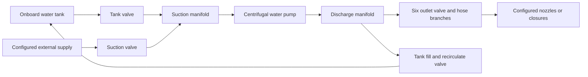

# B54 water flow simulation plan

Build a small, deterministic hydraulic simulation behind the existing B54 controls. The first usable version should let a learner supply water from a tank, change throttle, open and lock individual outlets, watch the outlets affect one another, and see the tank drain or recirculate. Calculate pressure and flow together from the connected water paths; neither throttle position nor handle extension should directly set a gauge reading.

Start with a clearly labeled **generic training preset** and an already filled pump and hose layout. Then calibrate a separate B54 profile using the confirmed tank and hose information below as truck records become available. This allows useful development without presenting invented pump curves or operating sequences as B54 facts. Manufacturer instructions and department procedures remain the authority for operating the actual truck; this plan concerns simulator behavior.

This is a plan only. It does not enable hydraulics, alter control mechanics, or require changes to the accepted truck geometry.

## Evidence and implementation baseline

| Item | Established evidence | Consequence for the simulation |
| --- | --- | --- |
| Pump identity | Original photograph `Pictures/B54/20261012_212049.jpg`: Waterous E511-A, serial 119059, October 2004, maximum discharge marking 220 PSIG. | Store the identity and rating as source-backed metadata. **220 PSIG is not a pump curve, normal pressure target, relief setting, or automatic pressure cap.** |
| Pump architecture | Waterous F-2390, issued September 2004 and revised March 27, 2017, identifies the E500 family as gear-driven centrifugal motor pumps with a three-cylinder 952 cc Briggs & Stratton Vanguard engine. Its model table identifies E511-A as diesel, with a 3-inch female NPT pump intake and 2-inch female NPT pump discharge. [Waterous F-2390, printed page 3](https://www.waterousco.com/media/pdfs/F2390.pdf#page=4) | Use a centrifugal pump driven by a dedicated motor as the supported architecture. Confirm B54's current engine, gearing, speed limits, and modifications before assigning numbers. Pump port sizes do not establish panel fitting or hose sizes. |
| Later model documentation | Waterous's current E501-C/E511-C page describes the Kubota version. [Waterous E501-C and E511-C](https://www.waterousco.com/product/e501c-e511c/) | Do not copy the C model's performance, engine, or electronic controls into the A model. No serial-specific B54 performance curve is established here. |
| Panel labels | Original photograph `Pictures/B54/20261012_211603.jpg` shows suction CLOSE left / OPEN right, TANK VALVE PULL TO CLOSE, TANK FILL RECIRCULATE, labeled outlets, a diesel-fuel label, intake/pressure instruments, and additional line gauges. | Directions and labels can be preserved. Concealed routing, check valves, gauge taps, and actual diameters still need a plumbing drawing or confirmation. |
| Foam system | Original photograph `Pictures/B54/20261012_212051.jpg` identifies a separate Hale V-Series foam system and depicts concentrate supply, pump, return, check valve, and venturi. | Keep water pumping and foam proportioning as separate subsystems. The foam PRIME position must never prime the main water pump. |
| Water tank | User confirmation on October 13, 2026: 300-gallon capacity. Use US gallons for this B54 profile: 300 US gal = 1.1356235352 m³. | Record the rated capacity as truck-confirmed. Usable volume, pickup height, tank shape, and overflow behavior remain separate inputs. |
| Preconnect hoses | User confirmation on October 13, 2026: standard 100-foot preconnects in both 1-inch and 1½-inch sizes. | Record two nominal hose classes, each 30.48 m long. Confirm individual branch assignments, nozzle ratings, and loss characteristics before calibrating their flow. This does not establish the booster-reel hose length. |
| Tank connections | User confirmed both requested connections on October 13, 2026: the lower tank valve supplies the pump from the onboard tank; TANK FILL / RECIRCULATE returns pump-discharge water to that same tank. | Treat these two path functions as truck-confirmed. Detailed piping, check valves, return termination, and any additional fill/bypass paths remain to be established. |
| Current application | `README.md`, `public/models/b54-controls.json`, `src/control-state.js`, `src/control-pose.js`, `src/main.js`, and `tests/controls.test.js`. There are 13 control roots, 12 active controls, static instruments, and no hydraulic or engine model. | Add a pure simulation core and a small integration layer. Retain the existing control contract and regression tests. |

The manufacturer's architecture supports a dedicated motor-pump model; that conclusion does not come from the OFF/RUN/START selector alone. The approved flush pump face, right walkway, three hose-bed lanes, and left-payout reel remain the visual arrangement. Their approximate mesh dimensions are not plumbing measurements. Original photographs stay in the ignored source folder and are not added to browser assets.

## What the learner should be able to observe

The first interactive exercise should make these relationships clear:

- An open supply path and water in the pump matter. An engine can run without delivering useful water.
- Increasing pump speed changes the available pressure-flow curve. Actual output also depends on intake conditions and the connected outlets.
- Opening another nozzle draws from the same pump. With a fixed speed and otherwise unchanged conditions, an additional comparable outlet usually lowers the common discharge pressure and changes flow through the first line.
- A partly open valve restricts its branch. Locking it preserves that opening; it does not regulate pressure or maintain a fixed flow when other conditions change.
- A closed nozzle can have pressure behind it while its flow is zero. Closing all outlets on a filled, supplied, running centrifugal pump can leave substantial discharge pressure.
- The tank valve supplies the pump. The tank-fill/recirculate path returns water to the tank. Returning water is not water delivered outside the truck.
- Recirculation alone does not create or consume tank water, apart from separately modeled losses. External supply can refill the tank if the configured path permits it.
- A tank eventually empties. Pressure and water delivery respond to supply loss; the simulator cannot continue delivering water from a negative tank volume.

Show intake pressure, main discharge pressure, individual line flow, total pump flow, water delivered outside the truck, and tank contents. Use US GPM, PSI/PSIG, and US gallons for the learner, with metric display optional. Initially show normalized pump speed rather than an invented B54 RPM reading.

Offer a small water-path diagram alongside the 3D panel. It should highlight flowing paths and show the direction and amount of flow. Its purpose is to explain a result such as “the second line reduced pressure” or “water is returning to the tank.” It should not suggest that the concealed pipe arrangement has been photographed or measured.

## Preserve the mechanical controls

`src/control-state.js` remains the authority for accepted handle movement. The hydraulic core receives copies of accepted state and never writes positions, rotations, or lock flags back into the controls. `src/control-pose.js` continues to apply movement in the exported parent basis independently of lock rotation.

| Existing control IDs | Hydraulic input | Required behavior |
| --- | --- | --- |
| `tank_fill` | Opening of the proposed discharge-to-tank return | Pulling out increases opening; pushing in closes. Route and check-valve behavior are profile settings until confirmed. |
| `hose_reel`, `right_preconnect`, `discharge_1`, `center_preconnect`, `discharge_2_5`, `left_preconnect` | Opening of one outlet valve each | Each branch has its own pipe/hose/nozzle or closure configuration. A handle alone does not imply an open nozzle or connected hose. |
| `tank_valve` | Opening of the tank-to-pump path | Reverse mapping: pushed in is open; pulled out is closed. Keep its provisional mechanical lock behavior unchanged. |
| `suction` | External intake valve closed/open | Left closed, right open; only two stable commands. Do not introduce a stable partly open suction setting. |
| `throttle` | Normalized speed demand | Counterclockwise/left increases. Its provisional one-turn range supplies a normalized command, not a measured engine-RPM conversion. |
| `engine_selector` | OFF, RUN, or START request | All three physical positions persist. The engine state machine may react to the request but cannot spring the selector back to RUN. |
| `hale_prime` | None while operation is unconfirmed | It remains inactive. No inferred suction pump, primer valve, timer, or hidden shortcut is assigned to it. |
| `foam` | Retained mechanical mode only in the water release | Left PRIME, center OFF, right OPERATE; locked means no translation. Foam hydraulics are a later extension. |

For an axial control with accepted value `x` and manifest range `[xmin, xmax]`, calculate normalized extension:

```text
u = clamp((x - xmin) / (xmax - xmin), 0, 1)
opening = u                 for normal pull-to-open controls
opening = 1 - u             for tank_valve
```

The adapter must read each manifest range, not hardcode the present 0.6 m artwork travel. Store the hydraulic valve characteristic separately: extension becomes a conductance through a configurable curve. A linear conductance curve is a reasonable explicitly assumed demo setting; **half extension does not mean half rated flow**. Actual valve linkage may have dead travel and a strongly nonlinear characteristic.

Continuous axial valves update while moving. Discrete suction, foam, and selector commands should use the last accepted detent, committed by the same release/endpoint action that settles the existing control. Do not let intermediate drawing positions invent an additional hydraulic mode. If a foam handle is locked at an intermediate visual position, retain its exact position and last committed mode; flag an unassigned mode if no prior detent exists. Do not snap a locked control to repair it.

Route pointer, keyboard, and endpoint-button actions through one small command bridge so they produce equivalent simulation inputs and recorded events. Locking alone must leave the opening bit-for-bit unchanged. Subsequent pressure changes may change flow through that opening, but must never move the handle.

## Model the water as a connected network

Represent boundary sources, junctions, pump, valves, hoses, nozzles, and tank as data. The initial network only needs two main unknown junction heads: the suction manifold and discharge manifold. Separate line nodes can be calculated along each branch after its flow is solved.



The tank-to-pump and pump-discharge-to-tank path functions are user-confirmed. The rest of this diagram is the **proposed training topology**. The arrows describe intended forward paths, not evidence that every path has a check valve. Each edge needs an explicit direction policy: bidirectional, one-way with a specified check valve, closed, or unsupported pending confirmation. In particular, do not silently add tank isolation, an automatic relief/bypass, or a direct external-fill connection.

For the first demo, one active water source is sufficient. Leave the external-intake path configurable and introduce simultaneous tank/external supply after its direction rules are tested. A pressurized external source should have a pressure-versus-flow characteristic or a source pressure plus finite supply-line resistance. An unlimited constant-pressure source is useful as a named test fixture, but must not masquerade as a real hydrant.

Each outlet configuration needs a termination: closed cap, open pipe, hose with closed nozzle, or hose with an open nozzle. Scenario setup supplies these states while the modeled caps and nozzles remain noninteractive. Avoid a scenario where a visibly capped connection emits water without an explanation. The confirmed 100-foot, 1-inch and 1½-inch preconnect classes supply nominal length/size information; do not assign either class to an unidentified branch or use nominal size as measured internal diameter. The hose reel needs its own total hose length in the flowing path, including wound hose if it remains connected in series; the visible paid-out distance is not automatically the loss length.

### Quantities and equations

Use SI internally: flow `Q` in m³/s, volume `V` in m³, pressure `p` in Pa, hydraulic head `h` in m, length/diameter in m, time in s, and speed in a consistently identified RPM or normalized-speed basis. Put all conversions in one tested module: 1 US gal = 0.003785411784 m³; 1 US GPM = 0.0000630901964 m³/s; 1 PSI ≈ 6894.757293 Pa. Do not mix US and Imperial gallons.

For the lumped junctions, use piezometric head `h = p_gauge/(rho*g) + z`. At the pump flanges, total pump head includes the velocity correction:

```text
H_pump = (p_discharge - p_suction)/(rho*g)
         + (z_discharge - z_suction)
         + (v_discharge² - v_suction²)/(2*g)
```

The first small-network approximation may neglect manifold velocity head, provided that choice is explicit. When importing a manufacturer curve, record whether its ordinate is differential pressure, total head, or a test discharge pressure under stated suction conditions. A flooded-suction discharge reading cannot automatically become net pump head. Gauge pressure is recovered at the particular gauge tap, not copied from every node.

Use these standard relationships as the physical basis: pipe losses from Darcy-Weisbach, fitting losses from velocity head, a fixed nozzle's square-root pressure relation, and speed scaling of a pump curve. EPA's network-model reference describes these elements and the distinction between reservoir and tank boundaries. [EPA EPANET network model](https://usepa.github.io/EPANET2.2/3_network_model.html)

```text
A = pi * D² / 4
v = Q / A
head loss = (f * L/D + sum(K)) * v² / (2*g)
fixed-nozzle Q = C_d * A_nozzle * sqrt(2 * delta_p / rho)

r = pump_speed / reference_pump_speed
H_pump(Q, r) = r² * H_reference(Q/r)       for r > 0
```

Use consistent Darcy friction factors, not Fanning factors. An effective measured loss curve `headLoss(Q)` is preferable to guessing pipe roughness or concealed fittings. For early development, a positive resistance `R` with `delta_h = R*Q*abs(Q)` gives a transparent model that can later be replaced by Darcy-Weisbach or measured tables. Here `R` has units s²/m⁵. Near zero flow, either use a smooth laminar transition or a separately tested zero-flow branch; avoid derivative singularities and division by zero.

For a partially open valve, define a conductance `C(opening)` and `Q = C * sign(delta_h) * sqrt(abs(delta_h))` when bidirectional flow is allowed. Closing the valve removes the edge exactly instead of assigning an arbitrarily huge resistance. Combine series losses without double-counting nozzle conversion or fitting losses. A real automatic or selectable nozzle needs its manufacturer's pressure-flow behavior; the fixed-orifice equation is only the initial nozzle class.

Use a small monotone table of flow/head points for the eventual pump curve, with piecewise linear interpolation to avoid overshoot. The table must carry its speed basis, source, and valid domain. Explicitly reject or report operation beyond that domain. Do not extrapolate to unlimited flow, reuse a different impeller's data, or multiply a pressure gauge by throttle percentage.

A synthetic demo curve can be `H = H0*r² - a*Q²` inside its defined forward-flow range. Its constants belong to the generic preset and are not estimates of E511-A performance. Zero speed is a separate passive-network mode, not evaluation of `Q/r`. Ideal affinity scaling also does not supply an engine power curve or guarantee that a real engine can hold every requested speed.

### Solver choice

Use a quasi-steady solve at each simulation step: calculate the pressure and flow operating point for the current speed, liquid state, boundary heads, and openings. Integrate only states that change with time, such as tank volume, engine speed, priming state, and optional temperatures. This makes the first implementation small, explainable, and testable in Node without Three.js.

For the initial parallel-branch topology, prefer bracketed scalar solves over a general unconstrained Newton solver:

1. Choose a trial forward pump flow `Qp` within the allowed curve range.
2. Solve the suction-manifold head `hs` such that all allowed source-path flows sum to `Qp`.
3. Obtain discharge piezometric head from `hd = hs + H_pump(Qp, speed) - (v_discharge² - v_suction²)/(2*g)` when flange velocity corrections are enabled, or omit that last term under the documented negligible-velocity approximation. Evaluate all outlet and return flows at that head.
4. Solve `Qp - sum(Qoutlets(hd)) - Qreturn(hd) = 0` as the outer scalar equation.
5. Reconstruct line pressures and verify continuity at both manifolds and every added junction.

With positive passive resistances and a decreasing pump curve, the suction head falls as trial flow increases; the resulting discharge head and outlet demand also fall. The outer residual is therefore monotone in the intended regime. Start with bisection for predictable behavior; consider a safeguarded faster method only if profiling warrants it. Preserve brackets when warm-starting from the previous tick. Use documented pressure/flow residual tolerances and a bounded iteration count, such as 48 bisections per scalar solve. Failure to find a valid bracket is a model or operating-domain event, not permission to reuse a stale result as if it converged. Suspend physical integration for that tick and expose the diagnostic; never advance tank volume using stale flows.

Handle special topologies before solving. All discharge paths closed can mean `Qp = 0` and `hd = hs + H_pump(0, speed)`, provided there is a filled pump and an anchored suction pressure. All source paths closed do not provide an unlimited suction reservoir. A completely isolated water-filled section has no unique pressure in a strictly incompressible steady model; mark its pressure unavailable or retain the last pressure explicitly as a simplified trapped-pressure state. Never assign atmospheric pressure solely because flow is zero.

If a later plumbing diagram introduces coupled internal loops, relief-valve active sets, or multiple interacting pumps that defeat this reduction, keep the same component interface and upgrade to a damped nodal solver with explicit closed/check-valve active sets. Use a general network engine such as EPANET as an independent steady-state comparison for compatible water-filled cases, rather than importing a full engine into the browser at the outset. EPA documents its available modeling components and verification resources. [EPA EPANET](https://www.epa.gov/water-research/epanet)

### Tank volume and return flow

Maintain one water ledger. Let `QtankOut` be signed tank-to-suction flow, `Qreturn` be signed discharge-to-tank flow, and `QdirectFill` be a separately configured external fill, if such a connection is confirmed:

```text
dVtank/dt = Qreturn + QdirectFill - QtankOut - Qoverflow - Qdrain

Qpump = sum(QexternalOutlet) + Qreturn
Qpump = QtankOut + QexternalIntake
```

These equations apply to the illustrated layout with no additional storage or leak branches. Once hose/pump filling is added, include their changing stored volumes in the global ledger too. Report pump-through flow separately from total nozzle flow and external water consumption.

For tank supply with recirculation only, `QtankOut = Qreturn` and tank volume stays constant. When an external intake is supplying the pump and the tank-fill valve is open, returned water can increase tank contents. Both situations use the same network and volume equations. The return's receiving head depends on its termination: a submerged outlet sees the tank water head; an atmospheric outlet above the water sees its outlet elevation. Store that distinction in the profile.

Use a tank level-versus-volume curve when available; a constant-area tank is an explicit demo approximation. Boundaries require event handling: integrate only to the instant of empty/full, apply the configured outlet/overflow boundary, then re-solve the rest of the step. Simple clamping after a full tick can silently create or destroy water. At a full tank, allow simultaneous recirculating inflow and outflow with zero net change. For net inflow, model the configured overflow or full-tank inflow restriction; do not blindly shut every tank return path.

An empty tank cannot supply liquid. Reopening its valve does not refill it. If low water exposes an outlet or draws air, transition the appropriate liquid/prime state rather than letting the solver request arbitrarily negative suction pressure. Simultaneous predicted return does not instantly re-wet a dry pickup; restoring that state needs the configured liquid level and filling/venting conditions.

## Engine priming and supply behavior

Keep engine state, pump liquid state, and the positions of their controls separate. A useful engine state set is stopped, ready, cranking, running, and stopping. A useful initial liquid-state set is dry, filled, and supply lost; a later priming stage can add filling, evacuating air, and air entrained. An unavailable water source and loss of prime are related but distinct conditions.

### First usable water release

Begin exercises with the pump and configured hoses already filled, and with a scenario-provided running drive. This isolates the water relationships while B54's starting and water-priming details remain unconfirmed. Scenario speed demand can still come from the real throttle handle through the adapter, labeled as normalized simulation speed.

In this mode, the actual OFF/RUN/START handle continues to move mechanically, but the display explicitly identifies the drive as scenario-controlled. Do not silently suggest that a moved selector completed a real starting sequence. A subsequent generic engine exercise can expose the proposed state machine with its own visible assumptions.

Use a first-order speed response with a configurable response time and rate limit. For a constant demand during a tick, an exponential update avoids a timestep-dependent overshoot:

```text
n_next = n_target + (n_current - n_target) * exp(-dt / response_time)
```

This is a chosen training approximation. Minimum throttle in a running engine profile should map to that profile's idle speed, not necessarily zero. Do not assume a pressure governor: the throttle commands speed, and pressure changes when demand changes. Later, compare hydraulic power `rho*g*Q*H` and estimated shaft power with available engine power; use efficiency and torque data before making load droop, stalling, or maximum-output behavior quantitative.

### Starting and stopping extension

Waterous's legacy manual contains different starting instructions for different panel variants and identifies separate priming equipment. [Waterous F-2390, printed page 5](https://www.waterousco.com/media/pdfs/F2390.pdf#page=6) The B54 exercise needs its actual panel configuration, any glow/reset behavior, and drive arrangement confirmed before scoring a starting procedure.

A generic engine state machine may treat entry into START as a start attempt with a configurable delay and success condition; RUN alone must not start a previously stopped engine. Returning to RUN is the learner's mechanical action, with no spring return. A stable START request must not trigger a fresh start event on every tick. Whether starter engagement continues, cuts out automatically, or raises a warning after the engine catches is a separate profile policy. Do not teach an unverified electrical interlock as B54 behavior.

OFF removes active driving torque and allows the configured spin-down response. It does not mechanically close valves, drain a charged hose, or reset every pressure. When the pump is stopped, a connected pressurized supply or gravity head may still produce water flow through an allowed passive path. Configure the stopped pump as a passive resistance, an isolated edge, or a confirmed bypass arrangement as appropriate. The first generic profile can support a named passive path; B54-specific engine-off flow remains unscored until that routing is known.

### Water priming extension

For a dry pump, opening an intake valve is not universal proof of a successful prime. A tank above the pump may flood it only if the real path permits liquid entry and air escape. Drafting requires the appropriate air-removal mechanism and a sealed, submerged intake path. Capture those as explicit prerequisites and configurable transitions.

While HALE PRIME remains inactive, offer separate setup states such as “pump already filled” and “pump unprimed.” The latter demonstrates missing water delivery without pretending to teach primer operation. Any instructor-only “set initial prime” action must be visibly a scenario setup action, not a panel shortcut.

After confirmation, model primer actuation, air volume, leakage, water arrival, and loss of prime. Quantitative priming time requires pump/air-path information; begin with documented scenario timing if a physical air model is not justified. Adding an intake air leak should cause a persistent supply problem until the configured cause is corrected, rather than an arbitrary gauge wobble.

## Optional fault models

Introduce faults only after the ordinary water paths and conservation tests pass. Keep each mechanism distinct so the feedback explains the cause.

| Mechanism | Initial representation | What is needed for quantitative B54 behavior |
| --- | --- | --- |
| Inadequate intake supply | Falling inlet pressure and reduced deliverable flow from the supply curve; supply-domain event when no liquid solution is valid | Intake piping, hose, source curve, lift, and strainers |
| Air ingestion or lost prime | Deterministic state transition with reduced/disabled pump head generation, while separately accounting for any valid passive supply path | Air-leak paths, pump hold-up, primer design, venting, tank outlet behavior |
| Cavitation | Educational indication of inadequate suction margin, distinct from air leakage | Water temperature, ambient pressure/elevation, pump NPSH requirement versus flow/speed, suitable margin and degradation data |
| Dry running | Accumulated exposure state when a rotating pump lacks its required water state | Evidence for actual thermal response and damage timing; no invented countdown to destruction |
| Low-flow heating | A configurable heat balance or initially a qualitative exposure indicator | Pump water volume, heat input at low flow, metal thermal mass, cooling, and actual return/bypass route |
| Hose charging | Finite stored water and a visible delay before nozzle delivery | Hose internal volume, starting water/air state, venting, and an accepted simplified filling law |
| Rapid valve closure | Defer pressure-wave simulation | Pipe/hose compliance, wave speed, geometry, and a transient solver; moving a needle quickly is not a water-hammer model |

For cavitation, use absolute pressure in the calculation. At the suction flange, a usable expression is `NPSHa = (p_suction_absolute - p_vapor)/(rho*g) + v_suction²/(2*g)`, with the elevation datum handled consistently. Available suction head depends on the system; required suction head depends on the pump and operating point. A negative gauge-pressure reading alone does not establish cavitation. [DOE and Hydraulic Institute pumping sourcebook, printed page 38](https://www.energy.gov/sites/default/files/2014/05/f16/pump.pdf#page=42)

Without a B54 NPSH curve, label any threshold as a scenario assumption. Do not present an invented threshold or a universal inlet-pressure limit as a measured pump characteristic. If head is derated, re-solve the entire network so nozzle flow, intake loss, and tank accounting remain consistent.

Waterous identifies overheating with inadequate circulation and seal damage from dry running. [Waterous F-2390, printed pages 1 and 5](https://www.waterousco.com/media/pdfs/F2390.pdf) For an eventual thermal model, keep pump water and tank water as separate well-mixed thermal volumes. Return flow transfers heat to the tank and can gradually warm it; recirculating the same water is not unlimited refrigeration. At zero delivered flow, hydraulic output power is zero but pump losses can still heat trapped water, so a heat model needs an idle/churning loss term rather than only `rho*g*Q*H`.

The 220 PSIG nameplate reference can drive a clearly labeled equipment-rating event. If the calculated pressure exceeds that reference, preserve the calculated result and report the event. A real relief valve, speed governor, or failure mechanism must be modeled explicitly before it changes the physics. A display-range clamp may limit needle travel but must not conceal the underlying value or overrange status.

## Browser architecture and presentation

### Keep three kinds of state separate

| State | Examples | Owner |
| --- | --- | --- |
| Mechanical control state | Accepted value, lock flag, committed detent | Existing control-state functions and the command bridge |
| Physical simulation state | Tank volume, drive speed, engine mode, pump liquid state, solved heads/flows, temperatures | Pure simulation modules |
| Display state | Needle angle, animated stream particles, highlighted flow path, formatted text | Three.js/DOM presentation adapters |

The data path is `accepted control state -> normalized commands -> simulation step -> readings -> visual update`. Gauge easing and particle animation never feed back into the hydraulic solve. An invalid or out-of-domain solution carries a status with its values so the UI cannot display stale data as current measured output.

Suggested module boundaries:

```text
src/simulation/units.js             Unit conversions and quantity validation
src/simulation/config.js            Profiles, provenance, schema checks
src/simulation/control-inputs.js    Manifest IDs/ranges to hydraulic commands
src/simulation/components.js        Curves, losses, nozzles, source boundaries
src/simulation/network.js           Topology, solve, residuals, special cases
src/simulation/state.js             Initial physical state and reset policy
src/simulation/step.js              Engine, water ledger, events, fixed tick
src/simulation/scenarios.js         Deterministic setup and scheduled events
src/simulation/readings.js          Sensor taps, units, quality/status
src/instruments.js                 DOM and later Three.js instrument updates
public/simulation/                 Generic preset and separate B54 profile
tests/simulation/                  Component, analytic, integration, replay tests
```

These are proposed files, not generated implementation. Keep `src/main.js` responsible for viewer orchestration, input wiring, and calling the simulation scheduler. It should not become the location for pump equations.

### Simulation clock

Start with a fixed 0.02-second step, or 50 Hz, as a design choice to validate. Use an accumulator driven by the render callback's monotonic timestamp. Capture commands at tick boundaries and record their tick index; replay uses those indexes rather than browser event timing. Use at most five catch-up steps in one render frame. If a long frame exhausts the budget, discard excess wall time, report that the exercise clock has slowed/paused, and preserve deterministic simulation time. Do not empty a tank instantly after a hidden tab wakes up.

Pause simulation when the document becomes hidden, clear the wall-clock accumulator, and resume with a fresh timestamp. Camera moves, resizing, and selecting a handle have no physical effect. Explicit scenario restart resets the physical state, event log, and controls together. Keep “Reset controls” distinct: it moves controls through the existing reset behavior but does not refill the tank or erase faults. The UI must make this distinction obvious.

Render at the device's normal rate and interpolate display values between solved snapshots. Update numeric DOM readings around 10 Hz and announce state changes accessibly without an aria-live pressure announcement every frame. Keep the solver on the main thread initially; target an ordinary tick under 2 ms on the development machine and measure it. Only introduce a worker if observed cost justifies the extra message/replay complexity.

### Gauges and visible water

The current `mergeStatic()` function batches noncontrol meshes, including the illustrated instruments. Therefore a later moving needle requires a stable instrument root and exclusion from static batching before merging. Existing gauge-generation names are not a sufficiently stable unique sensor contract, especially for the repeated discharge gauges.

The first release should use a compact numeric instrument panel and leave current gauge artwork clearly identified as static. A later instrument phase should add a separate gauge manifest specifying node/root, pivot, rotation axis, minimum/maximum, sweep direction, nonlinear or compound scale if needed, sensor tap, and source status. Preserve all 13 existing control roots and their transforms. Remove or replace the static needle for each converted gauge so two readings cannot appear at once.

Do not infer a gauge's plumbing tap from proximity to a handle. An instrument before a branch valve, after that valve, or at the nozzle can show different pressures. Represent isolated or overrange readings explicitly. Smooth needle motion with a display-only response time; tests should compare raw solved readings separately from the eased needle.

An optional water stream can use a lightweight ribbon, particles, or analytic jet shaped by nozzle flow. It should start only at a configured open nozzle with positive delivery, stop with zero flow, and avoid emitting from capped ports. It is explanatory animation, not a CFD calculation or an estimate of extinguishing performance. The flow diagram and numeric feedback are more useful than spray detail for the first release.

Extend the existing read-only `window.b54Viewer.snapshot()` with simulation tick/time, profile ID/version, commands, engine/liquid state, tank volume, raw sensor values, flows, cumulative water ledger, solver residuals, and active events. Keep browser QA separate from the headless tests. Do not add an unrestricted production mutation API just to make tests easy.

## Initial configuration contract

Keep hydraulics out of `b54-controls.json`; that file remains the visual/mechanical contract. Link a hydraulic profile by stable control ID and validate missing/duplicate bindings at load. Use unit-suffixed field names and reject nonfinite values, zero diameters, negative volumes, invalid speed ranges, nonmonotone curves, and edges whose nodes do not exist.

Each physical parameter should carry a status such as `photoConfirmed`, `manufacturerFamily`, `truckConfirmed`, `measured`, `assumedDemo`, or `unknown`, plus a source reference and any applicable range. Profile status is `incomplete`, `genericTraining`, or `b54Calibrated`. An `incomplete` profile is not executable; a mixture of guessed and measured values must not silently promote a profile to `b54Calibrated`.

An initial B54 record can contain unknown fields without being executable. A separate, complete generic preset supplies all the numbers for demo runs. The following is a schema sketch, not a ready-to-run truck configuration:

```json
{
  "schemaVersion": 1,
  "profileId": "b54-pending-calibration",
  "profileStatus": "incomplete",
  "identity": {
    "pumpMake": "Waterous",
    "pumpModel": "E511-A",
    "pumpSerial": "119059",
    "nameplateMaxDischargePsig": 220,
    "source": "Pictures/B54/20261012_212049.jpg"
  },
  "drive": {
    "architecture": "dedicated-motor-geared-pump",
    "architectureStatus": "manufacturerFamily",
    "engineModel": null,
    "idleRpm": null,
    "maximumRpm": null,
    "pumpToEngineSpeedRatio": null,
    "powerCurve": null,
    "throttleToSpeedCurve": null,
    "startPolicy": "unconfirmed"
  },
  "pump": {
    "curve": null,
    "curveSpeedBasis": null,
    "referenceRpm": null,
    "validFlowRangeM3s": null,
    "efficiencyCurve": null,
    "npshrCurveM": null,
    "stoppedFlowPolicy": "unconfirmed"
  },
  "tank": {
    "capacityM3": 1.1356235352,
    "levelVolumeCurve": null,
    "outletElevationM": null,
    "unusableVolumeM3": null,
    "overflowPolicy": "unconfirmed"
  },
  "preconnectHoseClasses": [
    {
      "id": "preconnect-1-inch",
      "lengthM": 30.48,
      "nominalDiameterM": 0.0254,
      "internalDiameterM": null,
      "branchIds": [],
      "nozzleCurve": null
    },
    {
      "id": "preconnect-1-and-a-half-inch",
      "lengthM": 30.48,
      "nominalDiameterM": 0.0381,
      "internalDiameterM": null,
      "branchIds": [],
      "nozzleCurve": null
    }
  ],
  "network": {
    "topologyStatus": "partiallyConfirmed",
    "confirmedControlPaths": {
      "tank_valve": "onboardTankToPumpIntake",
      "tank_fill": "pumpDischargeToOnboardTank"
    },
    "nodes": [],
    "edges": [],
    "controlBindings": [],
    "sensorBindings": []
  },
  "features": {
    "waterPrimerControl": "inactive",
    "foamSimulation": false,
    "waterHammer": false
  },
  "provenance": [
    {
      "parameters": [
        "tank.capacityM3",
        "preconnectHoseClasses",
        "network.confirmedControlPaths"
      ],
      "status": "truckConfirmed",
      "source": "User confirmation on 2026-10-13"
    }
  ]
}
```

Each edge will include `id`, `from`, `to`, component type, direction policy, a loss model, and a control binding when applicable. Hose edges additionally need length, internal diameter, elevation change, and their loss source; nozzle edges need a manufacturer curve or explicit demo orifice. Source definitions need water availability, boundary head/supply curve, temperature if used, and initial air state. Sensor bindings need a precise node or tap location and whether the reading is gauge or absolute.

Scenario files contain initial tank contents, source connection/availability, nozzle states, already-filled versus dry hose state, initial mechanical states, scheduled disturbances, and training objectives. Keep solver timestep/tolerances, visual easing, and educational thresholds separate from truck properties. Every replay saves both profile and scenario versions.

## Delivery phases and acceptance gates

| Phase | Concrete deliverable | Acceptance gate |
| --- | --- | --- |
| 1. Contracts and numerical core | Unit conversions, profile validation, pure control adapter, synthetic pump/loss/nozzle components, one-source water-filled network, headless fixtures | Analytic answers and conservation pass; every positive lock and reversed tank valve retain existing behavior. No B54 numerical claims. |
| 2. First interactive water exercise | Generic preset, pre-filled/pre-primed setup, throttle demand, all six outlet branches, tank supply, tank-fill return, fixed tick, numeric readings, water-path diagram, scenario restart | Multiple outlets interact; deadhead pressure exists at zero flow; tank drains correctly; recirculation conserves water; browser gestures and keyboard remain correct. This is the first useful learner release. |
| 3. External supply and engine states | Finite external supply characteristic, source changes, explicit backflow/check rules, generic start/stop model, passive engine-off path fixtures, dry/unprimed setup | Source pressure is not discarded when the engine stops; simultaneous supply/return conserves water; unprimed scenarios do not manufacture pump head; START persists physically. |
| 4. B54 calibration and instruments | Confirmed pump curve/speed data, tank and hose data, plumbing/sensor map, stable gauge roots, dynamic panel instruments, selected department exercises | Measured cases meet stated tolerances on held-out cases; instrument taps and scales are checked; unresolved aspects remain labeled and excluded from procedural scoring. |
| 5. Supply faults and time effects | Confirmed primer mapping if available; hose filling, air-leak scenarios, cavitation indication, dry-running exposure, heat model where justified | Each added state conserves stored water/energy as applicable, resolves reproducibly, and teaches the correct cause. Calibration supports any numerical thresholds or timings. |
| 6. Foam extension | Separate concentrate ledger, confirmed V-Series configuration, injection/return/check behavior, foam-ready indications | Foam PRIME remains distinct from water prime; supported outlets receive the expected mixture; no invented percentage mapping or concentration claim. |

Keep each implementation phase reviewable and commit it after its acceptance gate. A documentation plan commit is separate from a future implementation authorization. Prefer completing phase 2 before adding detailed faults, spray effects, or foam, because it establishes the behavior the later work depends on.

## Initial training scenarios

Use short exercises with a stated initial setup, a reachable objective, and a deterministic event schedule. Judge hydraulic outcomes separately from an operating sequence: a generic exercise can explain cause and effect without claiming to certify a B54 procedure.

| Scenario | Learner task and visible feedback | Availability |
| --- | --- | --- |
| One line from the tank | Adjust speed and one branch opening to a scenario-defined flow band; compare pressure, flow, and cumulative water use. | Phase 2 |
| Another line opens | Start with one line flowing, open a second configured nozzle, then restore the requested delivery if the preset has sufficient capacity. Show why the first line changed. | Phase 2 |
| Hold a valve setting | Lock a partly open handle, vary other demand, and observe a fixed opening with changing flow. Distinguish a mechanical lock from flow regulation. | Phase 2 |
| Return water to the tank | Compare a nozzle-flow case with a return-only loop. Show pump-through flow, external delivery, and net tank change side by side. | Phase 2 |
| Tank supply ends | Start near the configured usable-volume boundary, observe water delivery cease or change at supply loss, and identify the missing source. Restoring supply need not automatically restore prime. | Phase 2 with its simplified liquid-state model |
| External source changes | Change source pressure at a recorded tick; compare adequate supply, restricted supply, and an engine-off passive-path fixture. | Phase 3 |
| Filled versus unprimed | Compare otherwise identical setups and identify why speed alone does not produce the same output. Primer operation is only added after confirmation. | Phase 3 |

Record commands, event times, readings, water balance, and the preset version for a compact after-action trace. Allow pause and restart. Feedback should describe the observed cause, such as “the added line increased demand and reduced common pressure,” and use hysteresis/dwell time to avoid flashing pass/fail on each tick. Numeric targets and time windows belong to the scenario; B54-specific scoring requires the calibrated profile and an approved objective.

## Deterministic tests and validation evidence

Tests should verify physical relationships and state boundaries, not simply repeat implementation equations in a second function. Preserve the current control/GLB/camera tests and add the following independently checkable cases.

| Test | Expected result |
| --- | --- |
| Unit round trips | PSI/Pa, US GPM/m³/s, and US gal/m³ return the original value within conversion tolerance. |
| Synthetic one-outlet operating point | At reference speed, `H_pump = 100 - 1,000,000*Q²` m and branch loss `3,000,000*Q²` m, with equal source/outlet elevation and no intake loss, solve `Q = 0.005 m³/s` and discharge head `75 m`. These constants are exclusively a software fixture. |
| Synthetic second identical outlet | With the same pump and two identical branches, solve total flow `sqrt(100/1,750,000) ≈ 0.007559289 m³/s`, equal branch flows, and discharge head `42.857143 m`. Each original branch receives less flow than in the one-outlet case. |
| Synthetic half speed | In the one-outlet fixture at half reference speed, solve `Q = 0.0025 m³/s` and discharge head `18.75 m`. |
| Supplied deadhead | At reference speed with all discharge/return paths closed, pump flow is zero and the synthetic differential head is `100 m`; no tank water disappears. |
| Closed versus partly open valve | A fully closed edge has exactly zero flow. Increasing its opening at a fixed imposed head increases flow; the fully coupled system is then re-solved. |
| Lock semantics under changing load | Lock a fractional axial opening, change another nozzle and throttle, and attempt every input path. Handle value/pose and derived opening remain exactly unchanged while its flow may change. |
| Reverse tank mapping | Pulling the lower tank valve reduces the supply conductance; pushing it in restores the configured conductance. |
| Recirculation and delivered water | Return-only operation has positive pump flow and zero external delivery, with unchanged tank volume. With a nozzle added, net tank loss equals external delivery after accounting for other sources/stores. |
| Empty and full events | No negative contents or over-capacity hidden storage; final partial timestep is accounted for; a full tank can continue a balanced recirculation loop. |
| Passive engine-off source | In a separate synthetic passive path with a `20 m` source head and total resistance `2,000,000 s²/m⁵`, flow is `sqrt(20/2,000,000) ≈ 0.003162278 m³/s` despite zero pump speed. A configured closed path instead has zero flow. |
| No usable supply or dry pump | Active pump head is unavailable under the configured liquid-state rules. No negative-volume supply or unexplained successful prime appears. |
| Closed nozzle pressure | An already charged line with an open panel valve and closed nozzle has zero flow but retains connected static pressure; an isolated section is flagged according to its explicit trapped-pressure policy. |
| Rating versus physics | A synthetic case exceeding the 220 PSIG reference produces a rating event without pressure clamping. A separately configured relief branch alters the solve only through its physical flow. |
| Reset and pause | Resetting controls does not restore consumed water. Scenario restart does. Hidden-tab time does not advance the exercise or change a locked state. |
| Replay and render rate | The same tick-indexed actions produce the same physical trace with simulated 30, 60, and 144 Hz rendering, including long-frame and pause/resume cases. |
| Failed solve | Invalid brackets, impossible topology, and out-of-curve requests yield explicit statuses and bounded work; NaN, infinity, and stale readings never appear as normal results. |

Use an initial numerical target of relative error at most `1e-6` for the analytic smooth fixtures, with absolute floors near zero. Proposed solver acceptance limits are a continuity error no greater than `max(1e-9 m³/s, 1e-6 * characteristicFlow)` at each node, and a head-equation residual no greater than `1e-4 m`; define `characteristicFlow` from the profile's reference flow. Track the integrated water-ledger error with a proposed goal below `0.01%` of initial stored water plus cumulative external input over a ten-minute exercise, using a one-liter denominator floor for tiny fixtures. Do not inflate that denominator by counting repeated internal recirculation. These are software acceptance targets, not accuracy claims for the truck. Adjust them only with a written reason and a measured error budget.

For browser QA, verify direct pointer operation from the pump view and an oblique view, narrow and desktop layouts, keyboard equivalence, exact positive locks, gauge readability, pause/resume, and scenario restart. Read the simulation snapshot to compare raw values with what the instrument panel displays. Retain `npm test`, `npm run validate:model`, and `npm run build`; update the test script deliberately if new tests are placed below a subdirectory, because the current `tests/*.test.js` glob does not include nested files. A passing build is not evidence that rendered controls or gauges work.

For B54 calibration, record the conditions behind each trusted observation: engine/pump speed basis, inlet and discharge pressure taps, flow measurement, source arrangement, tank level, hose/nozzle configuration, water temperature when relevant, and instrument uncertainty. Fit the smallest number of justified parameters and reserve separate observations for validation. Report errors by condition; do not promise a universal percentage before the measurement quality is known. Existing pump-test records or manufacturer serial-specific data are preferable to inventing new live tests. Any real-truck data collection follows the department's approved process.

## Foam extension

Hale's original manual describes the V-Series as a venturi-based balanced-pressure system with a separate foam pump/motor and cable-operated metering control. Concentrate is introduced into the water discharge stream; foam priming circulates concentrate through a return path. The manual covers more than one model and includes proportion settings beyond a simple on/off mode. [Hale FoamMaster V-Series manual, printed pages 7 and 18](https://www.godiva.co.uk/media/pdf/029-0020-55-0-C_FoamMaster_V-Series_Inst_and_Oper_Inst.pdf)

The later extension needs B54's exact V-Series model, control calibration, concentrate capacity, enabled discharge branches, venturi position, check valves, power behavior, and return/flush routing. The manual's variants have different ratings; the water-pump nameplate is not a rating for the complete foam installation. Retain the existing three-position user-confirmed foam mechanics until further confirmation; do not derive a precise concentrate percentage from the right-hand OPERATE position or add a new physical travel range based on the generic manual.

Track water, concentrate, and solution as distinct quantities with a stated concentration convention. PRIME returns concentrate according to the confirmed route and does not imply solution at a nozzle. OPERATE consumes concentrate only when the configured system is available and water flows through the injection path. OFF stops concentrate addition but need not instantly remove mixture already in the line. Water-side venturi losses may belong in the water profile even when concentrate injection is disabled. Confirm their location before applying them to every outlet or to the tank return.

## Priority questions and next work

Tank capacity, the two 100-foot preconnect hose classes, and both tank path functions are now confirmed. The user may obtain apparatus or pump documents later in the week; those can supply the remaining calibration inputs. The following information changes numerical accuracy or procedural scope; it does not block the generic phase 1 and phase 2 work.

| Priority | Information needed | Best evidence | What it unlocks |
| --- | --- | --- | --- |
| 1 | B54 pump performance curve, reference speed, present engine model, pump/engine ratio, idle/governed range | Waterous records for E511-A serial 119059, engine plate, apparatus documentation, existing pump-test records | Real pressure/flow/RPM behavior and power limits |
| 1 | Unusable tank volume, outlet/fill heights, detailed tank path losses and return termination, check valves, bypass/relief hardware | Apparatus builder's plumbing schematic and tank specification; confirmed labeled inspection | Correct depletion, source switching, recirculation, overflow, and stopped-pump behavior |
| 1 | Assignment of the confirmed preconnect hose classes to branches, internal diameter/loss data, booster-reel length/size, nozzle make/model/settings, branch plumbing losses | Hose/nozzle inventory and manufacturer data; existing measured loss data | Credible individual line flows and required pressure relationships |
| 2 | Gauge ranges and actual pressure-tap locations; what each line gauge measures | Instrument close-ups plus plumbing/sensor map | Correct dynamic panel gauges and meaningful exercise readings |
| 2 | Exact engine start/reset/glow sequence and HALE water-primer operation | B54 operating documentation and knowledgeable operator confirmation | Procedural starting and priming exercises without inventing actions |
| 2 | Valve opening characteristics versus accepted handle extension | Valve/linkage identification or approved observations | Meaningful partly open settings and restriction behavior |
| 3 | NPSH, pump hold-up, temperature response, air leakage and hose charging behavior | Manufacturer information or suitable approved data | Quantitative fault timing and higher-fidelity transient effects |
| 3 | Exact Hale V-Series model, concentrate tank, percentage mapping, foam discharge routing | Foam nameplate, builder diagram, manufacturer configuration | Foam simulation after water behavior is sound |

The immediate implementation sequence is to define the parameter/provenance schema, write the synthetic analytic fixtures, build the pure one-source solver and control adapter, and then connect a generic pre-filled water exercise to the current viewer. The first review should demonstrate a locked partly open line, another line opening, a visible pressure/flow change, tank depletion, and a return-only loop with no net water loss. That provides a useful, testable foundation while the B54 calibration record is completed.
